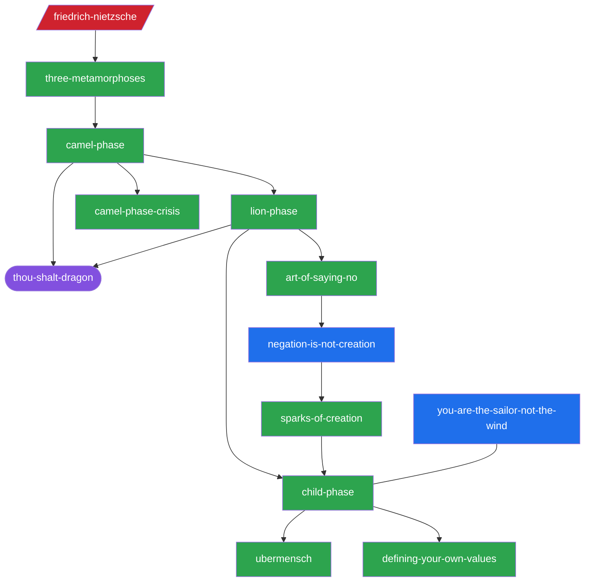

# Knowledge Graph — Master Navigation

> How the whole system connects. With 256 pages, one diagram won't fit — so this is a
> **structured index**: the worldview spine, the four strata with their load-bearing pages,
> the principles, the recurring mascots, and pointers to every other map. A detailed
> Mermaid graph for **Chapter 3** is kept at the bottom as the worked example of how a
> single cluster links up.

## Start here
- **The architecture:** [[worldview-spine]] — the master metaphor, the camel→lion→child engine, the four strata.
- **The biases:** [[bias-catalog]] — all ~40 cognitive biases & fallacies, grouped.
- **The arc, page by page:** [[moc-three-metamorphoses]] — a reading path through Ch.3.
- **Cross-chapter threads:** [[themes]] · **Tensions:** [[contradictions]] · **Open questions:** [[gaps]] · **Quotables:** [[gold-nuggets]] · **Status:** [[build-log]].

---

## The 20 principles (the irreducible layer)
- [[you-are-the-sailor-not-the-wind]] · [[define-values-before-setting-course]] · [[negation-is-not-creation]] · [[courage-is-acting-despite-fear]] (Ch.3)
- [[fill-your-own-cup-first]] · [[self-esteem-is-earned]] · [[money-follows-value]] (Ch.4)
- [[the-map-is-not-the-territory]] (Ch.5)
- [[evolutionary-mismatch]] (Ch.2)
- [[most-fears-are-memories]] (Ch.6)
- [[meaning-is-created-not-found]] (Ch.9)
- [[consistency-beats-restarting]] · [[explain-dont-force]] (Ch.10)
- [[mood-follows-action]] · [[discipline-over-motivation]] · [[change-what-you-can-accept-what-you-cant]] · [[pain-vs-suffering]] · [[memento-mori]] (Ch.8)
- [[the-journey-is-the-destination]] · [[change-begins-with-a-decision]] (Ch.1)

## The four strata (the architecture beneath the chapters)
See [[worldview-spine]] for the full model. Load-bearing concepts per stratum:

### 1. Inheritance — what we're given (camel)
[[evolutionary-mismatch]] · [[vestigial-structures]] · [[vestigial-mind-wirings]] · [[fight-or-flight]] · [[jealousy-as-evolutionary-relic]] · [[the-subconscious-mind]] · [[system-1-and-system-2]] · [[internalizing-the-exterior]] · [[camel-phase]] · [[success-failure-societal-script]] · [[limiting-beliefs]]

### 2. Liberation — seeing & loosening the programming (lion)
[[becoming-the-observer]] · [[the-map-is-not-the-territory]] · [[cognitive-bias]] (+ the [[bias-catalog]]) · [[memory-as-editable-film]] · [[anchoring]] · [[emotional-baggage]] · [[the-problem-is-not-the-problem]] · [[lion-phase]] · [[art-of-saying-no]] · [[the-inner-critic]] · [[self-compassion]] · [[pain-vs-suffering]]

### 3. Authorship — creating your own life (child)
[[defining-your-own-values]] · [[child-phase]] · [[self-esteem]] · [[financial-literacy]] (+ [[asset-vs-liability]], [[financial-independence-number]]) · [[atomic-habits]] · [[thermostat-vs-thermometer]] · [[taking-responsibility]] · [[be-proactive]] · [[decluttering]] · [[pareto-principle]] · [[start-with-the-end-in-mind]] · [[winners-do-things-differently]]

### 4. Meaning — orienting the whole (übermensch)
[[the-will-to-meaning]] · [[ikigai]] · [[pure-model]] · [[the-existential-void]] · [[frankls-values]] · [[your-mission-is-bigger-than-your-objectives]] · [[doing-what-you-love-is-loving-the-mission]] · [[intention-in-context]] · [[the-prisoners-dilemma]] · [[generous-tit-for-tat]] · [[awakening-the-point-in-the-heart]] · [[ubermensch]]

## Recurring mascots & master metaphors (content-engine fuel)
- **The sailor & the sea** → [[you-are-the-sailor-not-the-wind]]
- **Cammy** the camel→lion→child → [[cammy-the-camel]]; the **Thou-Shalt Dragon** → [[thou-shalt-dragon]]
- **Rocky the Stoic Dog** → [[rocky-the-stoic-dog]]
- **Pip, Pop & Smokey** the habit penguins → [[the-habit-penguins]]
- **The Existential Supermarket** → [[the-existential-supermarket]]
- **The Intention Donut** → [[the-intention-donut]]
- **The Mind Cinema / Thought Boats** → [[the-mind-cinema]], [[the-thought-boats]]
- **The Boiling Frog / Bookshelf of Life / Ruler of Life** → [[the-boiling-frog]], [[the-bookshelf-of-life]], [[the-ruler-of-life]]
- **Insects & Artificial Light** → [[insects-and-artificial-light]]

## Syntheses (resolving the book's polarities — *not in the book*)
Analysis layered on top, via [[polarity-thinking]] (add the missing dimension). See [[contradictions]].
- [[acceptance-and-change]] — **C0, the central polarity**: accept the sea, choose the heading.
- [[values-discovered-and-created]] — C1: signals discovered, commitments created.
- [[friction-vs-divergence]] — C2 (+gap G1): repair friction, release divergence.
- [[the-money-happiness-curve]] — C7: money buys freedom from suffering, not meaning.
- [[human-worth-vs-self-respect]] — C8: worth is given, self-respect is earned.

## The influences synthesized
[[friedrich-nietzsche]] · [[viktor-frankl]] · [[daniel-kahneman]] · [[james-clear]] · [[abraham-maslow]] · [[robert-axelrod]] · [[stephen-covey]] · [[nlp-bandler-grinder]] · [[gabor-mate]] · [[tony-robbins]] · [[jim-rohn]]

---

## Worked example — Chapter 3 detailed graph



The full Ch.3 edge list (every relationship spelled out) is preserved below as the
template for how any cluster's links are documented.

### Edge list (LLM-friendly, Chapter 3)
```
three-metamorphoses --stages--> camel-phase, lion-phase, child-phase
child-phase --opens-onto--> ubermensch
camel-phase --turns-at--> camel-phase-crisis
camel-phase --obeys--> thou-shalt-dragon
lion-phase --core-skill--> art-of-saying-no
art-of-saying-no --illustrates--> negation-is-not-creation
negation-is-not-creation --resolved-by--> sparks-of-creation --ignites--> child-phase
child-phase --creative-act--> defining-your-own-values --hears--> inner-voice
friedrich-nietzsche --source-of--> three-metamorphoses, thou-shalt-dragon, ubermensch
jim-rohn --seeds--> you-are-the-sailor-not-the-wind
you-are-the-sailor-not-the-wind --posture-for--> child-phase, defining-your-own-values
```

## Next for this map
Build a compact Mermaid cluster (like the Ch.3 one above) for each chapter, or one per
stratum. Every page already carries its own `related:` edges in frontmatter, so the graph
can also be generated mechanically from the codex (a future `03-engine/tools/` script).
